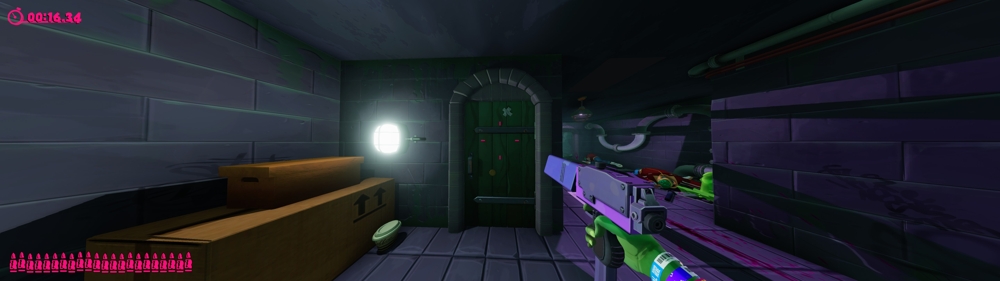

# Anger Foot — Ultrawide Viewmodel FOV Fix

A BepInEx 5 plugin that makes the hands and guns in Anger Foot follow the in-game **Field Of View** slider, so they look right at high FOV on ultrawide and super-ultrawide screens (21:9, 32:9 and wider).

Windows only. Single-player game, no anti-cheat.

| After (this fix, 32:9, FOV 120) |
|---|
|  |

## Features
- **Viewmodel follows the FOV slider.** The hands and guns shrink or grow exactly like the world does when you change the FOV.
- **Live tuning keys** (F5/F6) for the viewmodel size, saved automatically.
- **Optional 16:9 placement:** pushes the hands out towards the screen edges like they sit on a 16:9 screen.
- **Leaves the game's zooms alone:** aim-down-sights and scripted camera zooms behave as before.
- **One-key A/B toggle** (F8) and a log file for troubleshooting.

## Requirements
- Anger Foot (Steam). The game runs on Unity **2019.4.35f1** (Mono).
- [BepInEx 5](https://github.com/BepInEx/BepInEx/releases) x64. The release zip already includes BepInEx **5.4.23.2**.

## Install
### Release
1. Download the latest zip from [Releases](https://github.com/Ferosnow95/AngerFootFix/releases).
2. Extract it into the game folder, next to `Anger Foot.exe`. You should get `winhttp.dll`, `doorstop_config.ini` and a `BepInEx` folder.
3. Launch the game. BepInEx creates `BepInEx\config\ferosnow.angerfoot.ultrawide.cfg` on the first run.

Steam Deck / Linux (Proton): set the launch option `WINEDLLOVERRIDES="winhttp=n,b" %command%`.

### From source
1. Install BepInEx 5 x64 into the game folder and run the game once.
2. Build: `dotnet build src/AngerFootUltrawide -c Release -p:GameDir="<path to Anger Foot>"`
3. Copy `AngerFootUltrawide.dll` into `Anger Foot\BepInEx\plugins\AngerFootUltrawide\`.

The maths has its own tests: `dotnet run --project tests/FovMathTests`.

## Controls
| Key | Action |
|---|---|
| F5 / F6 | Viewmodel FOV -1° / +1° (bigger / smaller hands and guns). Saved automatically. |
| F8 | Toggle the fix on/off (restores the game's own viewmodel) |
| F7 | Write the camera values to the log |

## Configuration
Adjust settings in `Anger Foot\BepInEx\config\ferosnow.angerfoot.ultrawide.cfg`.

| Setting | Default | What it does |
|---|---|---|
| `Enabled` | `true` | Turns the fix on. Same as F8. |
| `FollowStrength` | `1` | How much the viewmodel follows the FOV slider. `1` = exactly like the world, `0` = the original game, `0.5` = halfway. |
| `ViewmodelFovOffset` | `0` | Extra viewmodel FOV in degrees. Positive = smaller hands/guns, negative = bigger. F5/F6 change it. |
| `Match16x9Placement` | `false` | Also widens the viewmodel for your aspect ratio, so the hands sit where they would across a 16:9 screen (out towards the edges at 32:9). The hands and guns get smaller. |
| `VerboseLog` | `false` | More logging. |
| `Toggle` / `Dump` / `OffsetDown` / `OffsetUp` | `F8` / `F7` / `F5` / `F6` | Key bindings. |

## Known issues
- Hands and guns are one rig that sits near the centre of the screen. The fix scales them with the FOV; it doesn't move each hand separately. Use `Match16x9Placement` if you want them further out.
- Developed and tested on one PC (32:9, 5120×1440). Reports from 21:9 and 48:9 (triple-screen) setups are welcome.

## Troubleshooting
The plugin writes `BepInEx\plugins\AngerFootUltrawide\AngerFootUltrawide.log` (the previous session is kept as `AngerFootUltrawide.prev.log`). Each `RESULT` line shows the slider value and the viewmodel FOV it became. If the plugin doesn't load at all, check `BepInEx\LogOutput.log`. Press F7 in game and attach both logs to an issue.

To uninstall, delete `winhttp.dll` (disables BepInEx) or the `BepInEx\plugins\AngerFootUltrawide` folder.

## Changelog
See [CHANGELOG.md](CHANGELOG.md).

## License
Distributed under the MIT License. See [LICENSE](LICENSE).

## External tools and credits
- [BepInEx](https://github.com/BepInEx/BepInEx) (LGPL-2.1) and [HarmonyX](https://github.com/BepInEx/HarmonyX) — the plugin loader and patching library. BepInEx 5.4.23.2 is included unchanged in the release zip.
- [ILSpy](https://github.com/icsharpcode/ILSpy) — used to read the game's camera code.
- [PolarWizard/CodeVeinFix](https://github.com/PolarWizard/CodeVeinFix) — README format.
